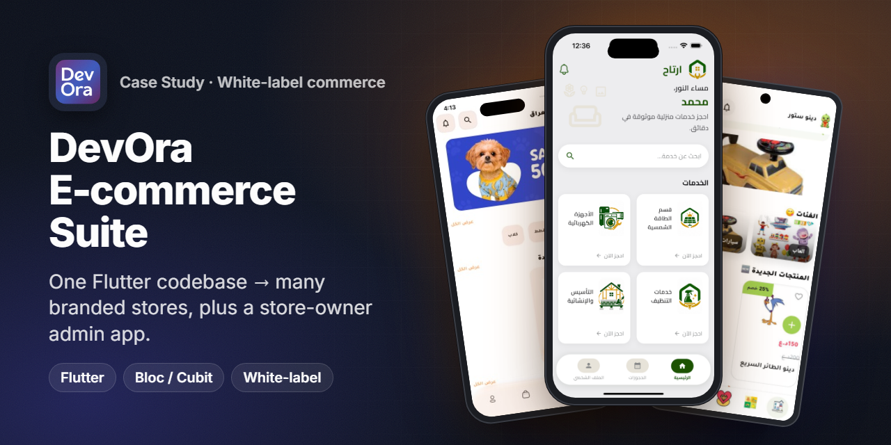
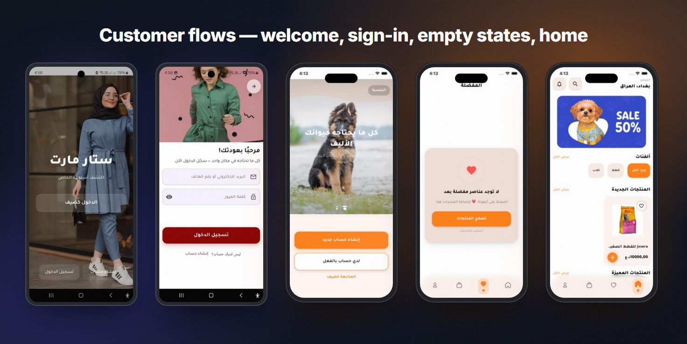
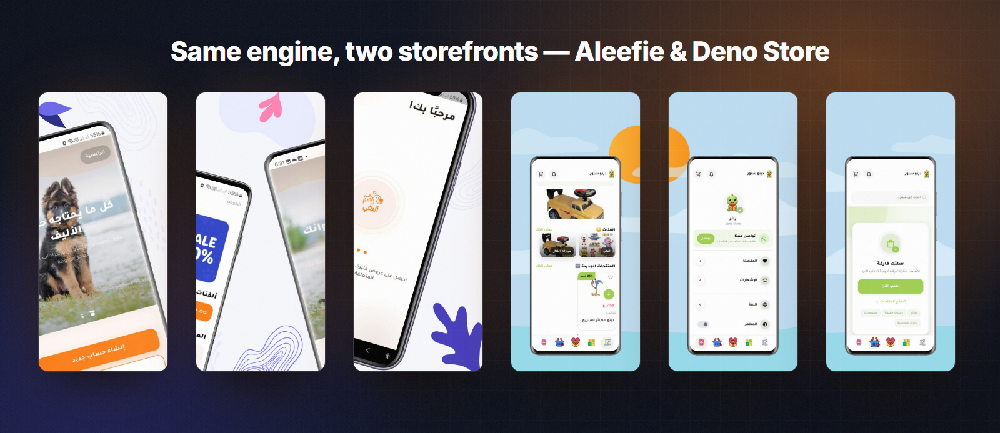
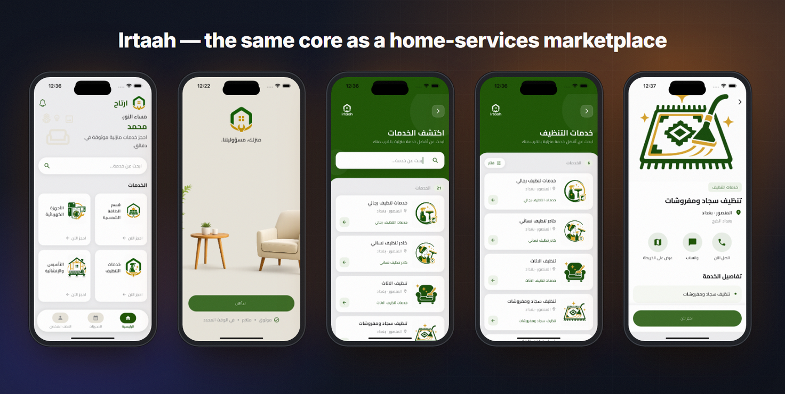
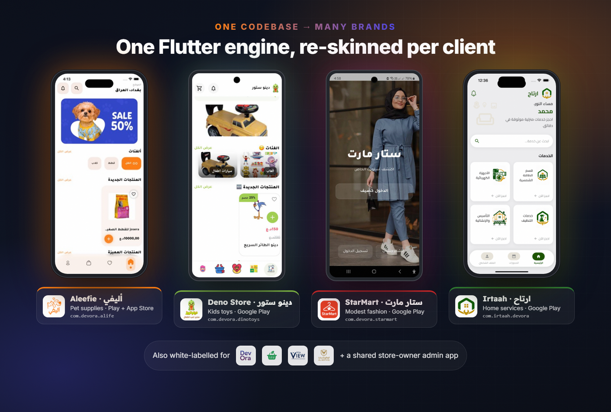
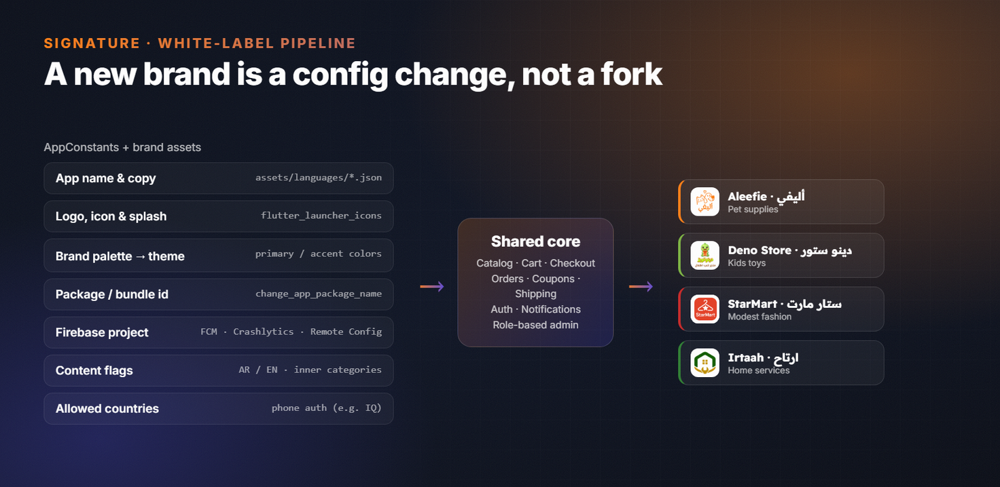
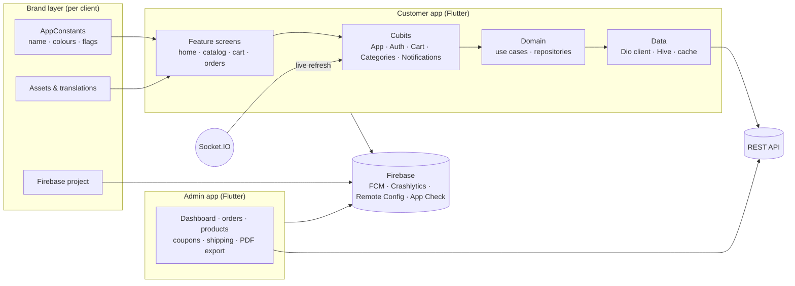

<h1 align="center">DevOra E-commerce Suite</h1>

<b>One white-label Flutter codebase that ships as many branded stores — pets, toys, fashion, home services — plus the store-owner admin app.</b>

  
  
  
  
  
  

  
  
  
  
  

> ℹ️ Case study — the source code is proprietary to the client and is not included.

## Overview

**DevOra** sells ready-made, branded mobile stores to merchants (mainly in Iraq). Instead of building every store from scratch, I built **one Flutter customer app and one admin app** that can be re-branded per client — name, logo, colours, copy, package id, Firebase project and feature flags — and shipped to Google Play and the App Store as an independent app.

| | |
|---|---|
| **Product** | White-label e-commerce: customer app + store-owner admin app |
| **Market** | Iraq (Arabic-first, RTL, IQD pricing, Iraqi phone auth) |
| **Live brands** | Aleefie (pets), Deno Store (toys), StarMart (fashion), Irtaah (home services) |
| **Other builds** | Pets, Grocery, OCA View, Al-Wathiq storefronts from the same core |
| **My role** | Lead Flutter developer — shared core, white-label workflow, admin app, store releases |
| **Timeline** | 2025 (Aleefie reached the App Store in October 2025) |

## The challenge

- **Many clients, a small team.** Every new merchant wanted "their own app" in weeks, not months. Keeping a separate codebase per store would have multiplied bugs and maintenance.
- **Different verticals, same plumbing.** A pet shop, a toy store, a fashion brand and a home-services company all need catalog, cart, checkout, orders, coupons, notifications and an owner dashboard.
- **Store owners are not technical.** They manage products, orders, banners, coupons and shipping fees from their phone.
- **Arabic-first UX.** RTL layouts, Arabic copy, Iraqi phone numbers and IQD prices across every brand.

## Highlights

**🛍️ Customer app**
- Home with promo banners, categories, sub-categories, "new" and "featured" product rails
- Product details, favourites and a **guest cart** stored locally (Hive) that survives until sign-in
- Checkout with coupons, shipping fees by area and order confirmation; "My orders" history
- Sign-in by **phone OTP**, email/password, **Google** and **Facebook**; biometric unlock (`local_auth`)
- Address and location with Google Maps / geolocation
- Push notifications (FCM + local notifications) and an in-app notifications centre
- Arabic / English with `easy_localization`, light / dark appearance

**🧑‍💼 Store-owner admin (separate app + role-gated screens)**
- Dashboard with charts (`fl_chart` / Syncfusion)
- Orders board with status chips (*not confirmed → in progress → shipped → delivered / canceled*), date filters, bulk selection and status updates
- **PDF export** of orders and customer lists (`pdf` + `printing`)
- Products, categories and inner categories; ads/banners; coupons; shipping zones and fees
- Store info, About and Privacy pages, reviews moderation, customer chat, QR scanner
- Permission-based access (`hasPerm`) so staff only see what their role allows

**🔁 White-label tooling**
- A single `AppConstants` file + brand assets define each store
- A documented 9-step rebrand checklist (name, icon, package id, Firebase project, colours, fonts, copy, SHA keys)

## Screens

StarMart (Android) and Aleefie (iOS): welcome, sign-in, onboarding, empty states and home — same screens, different brand.

Official store screenshots for Aleefie (pets) and Deno Store (toys).

Irtaah: the same core configured as a home-services marketplace — services, booking, call / WhatsApp / map actions.

## Signature feature — one codebase, many brands

Every store above runs the **same Flutter code**. What changes is configuration:

**How it works**
1. **Brand config** — `AppConstants` holds the app name, logo, brand colours, onboarding content, allowed countries for phone auth, and content flags (Arabic / English content, inner categories).
2. **Brand assets** — icon, splash, onboarding images and translation files are swapped per brand; launcher icons are generated with `flutter_launcher_icons`.
3. **Identity** — `change_app_package_name` sets the package / bundle id (e.g. `com.devora.alife`, `com.devora.dinotoys`), and each brand gets its own Firebase project (FCM, Crashlytics, Analytics, Remote Config, App Check).
4. **Server-driven content** — banners, categories, products, coupons, shipping and store info come from the backend, so the store owner (through the admin app) controls the storefront without a new release.

Result: a new brand is a configuration task, and a fix in the core ships to every store.

## Architecture & stack

| Layer | Tech |
|---|---|
| UI | Flutter, `flutter_screenutil` / `sizer`, Google Fonts, Lottie, shimmer, carousel |
| State | `flutter_bloc` (Cubit) — App, Auth, Admin, Map and per-feature cubits |
| Architecture | Feature folders; cart, categories, products, notifications and phone-auth split into **data / domain / presentation** with use cases and repository interfaces |
| Networking | Dio (REST), `socket_io_client` for real-time events |
| Local data | Hive (guest cart, favourites), shared-preferences cache |
| Auth | Phone OTP, email/password, Google Sign-In, Facebook Login, `local_auth` biometrics |
| Firebase | Messaging, Analytics, Crashlytics, Performance, Remote Config, App Check |
| Maps | `google_maps_flutter`, `geolocator`, `geocoding` |
| Admin | `fl_chart`, `pdf` + `printing`, `mobile_scanner`, `file_picker` |
| i18n | `easy_localization` (Arabic / English, RTL) |

## Engineering notes

- **Brand isolation without forks.** All brand-specific values live in one constants file and the assets folder; the rest of the code reads from them. A written checklist at the top of the file turns a new brand into a repeatable routine (icon → package id → Firebase → colours → copy → signing keys).
- **Guest-first shopping.** Shoppers can browse, favourite and fill a cart before creating an account. The guest cart (with product variants) and favourites live in Hive boxes. After sign-in, the cart is pushed to the server once per session, and only the items the server accepted are removed locally — so nothing is lost on a weak connection, and there is no "sign up first" wall.
- **Live storefront updates.** A Socket.IO connection joins a `users` room; when the owner changes something in the admin app, a `general` event tells the customer app to refresh — no polling.
- **Role- and permission-based admin.** Login stores the user's role and permission list; admin screens and actions check `hasPerm(...)`, so the same admin build serves owners and staff with different rights.
- **Owner-friendly reporting.** Orders and customers can be filtered by status and date and exported as PDF straight from the phone for bookkeeping or the delivery company.
- **Production monitoring per brand.** Crashlytics, Performance and Analytics are initialised at startup, Remote Config drives runtime switches, and App Check protects the Firebase backend for every brand.

## Results

- **4 brands live on Google Play** from one codebase: Aleefie, Deno Store, StarMart, Irtaah.
- **Aleefie also live on the App Store** (Shopping, released October 2025).
- **10 app builds** (customer + admin) maintained from the same core, including the Pets, Grocery, OCA View and Al-Wathiq storefronts.

## بالعربي

**DevOra** منظومة متاجر إلكترونية "وايت ليبل": تطبيق عميل واحد وتطبيق إدارة واحد مبنيين بـ Flutter، ويتم إعادة تسميتهما وتلوينهما لكل عميل ونشرهما كتطبيقات مستقلة.
من نفس الكود خرجت **أليفي** (مستلزمات الحيوانات الأليفة)، **دينو ستور** (ألعاب أطفال)، **ستار مارت** (أزياء)، و**ارتاح** (خدمات منزلية) — كلها منشورة على Google Play، وأليفي على App Store أيضًا.
التطبيق يدعم السلة كزائر، تسجيل الدخول برقم الهاتف وجوجل وفيسبوك، الكوبونات والشحن حسب المنطقة، الإشعارات، والتحديث اللحظي عبر Socket.IO.
وتطبيق الإدارة يتيح لصاحب المتجر إدارة الطلبات والمنتجات والإعلانات والكوبونات وتصدير التقارير PDF من الموبايل.
دوري: قائد تطوير Flutter — بناء النواة المشتركة، آلية الـ white-label، تطبيق الإدارة، والنشر على المتاجر.

## Links

- Aleefie · أليفي — [Google Play](https://play.google.com/store/apps/details?id=com.devora.alife) · [App Store](https://apps.apple.com/sa/app/id6753914523)
- Deno Store · دينو ستور — [Google Play](https://play.google.com/store/apps/details?id=com.devora.dinotoys)
- StarMart · ستار مارت — [Google Play](https://play.google.com/store/apps/details?id=com.devora.starmart)
- Irtaah · ارتاح — [Google Play](https://play.google.com/store/apps/details?id=com.irtaah.devora)

---
<h3 align="center">Built by Mahmoud Shaker — Senior Flutter Engineer</h3>

  
  
  
  
  
  
  

